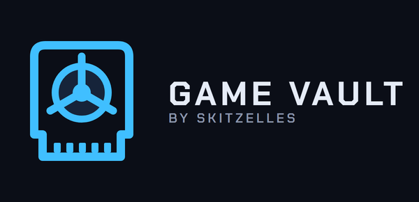
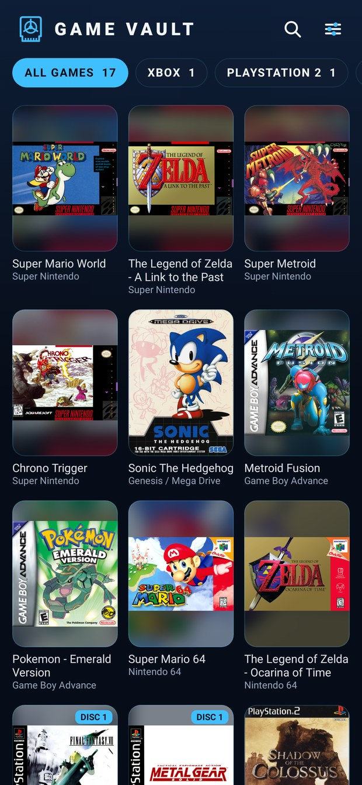
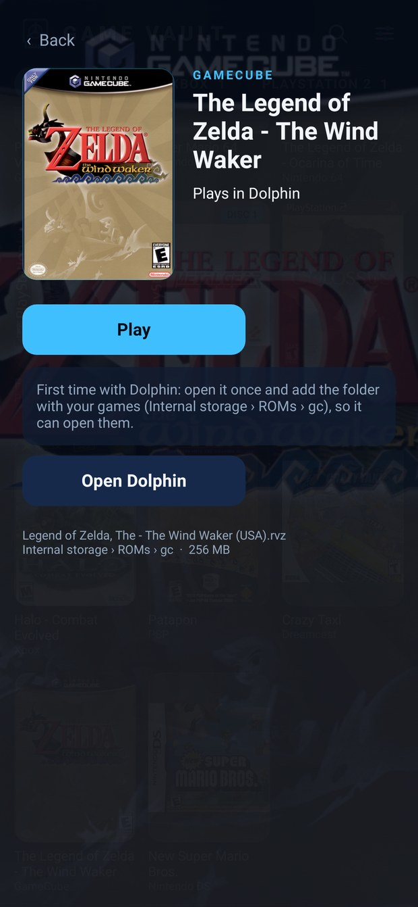
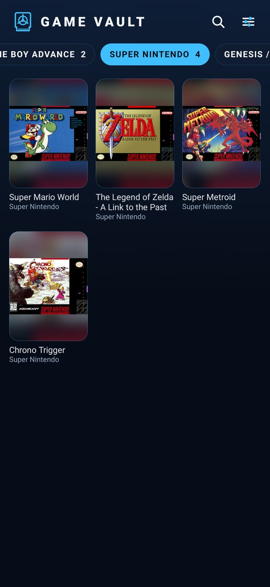

  

<h3 align="center">Every game. One vault. Now in your pocket.</h3>

  <b>Put games on your phone, pick one, play.</b> 
  The all-in-one game library for <b>Android</b>: phones, tablets and Android TV. Atari to PlayStation 2,
  GameCube, Wii and the original Xbox, with touch or a controller.

  
  &nbsp;
  
  &nbsp;
  

  
  
  
  
  
  

  
  &nbsp;
  
  &nbsp;
  

<table align="center">
  <tr>
    <td align="center" width="33%"><h3>📱 1. Put games on</h3>The phone, an SD card or a USB drive. Any folders, any names, zipped or not.</td>
    <td align="center" width="33%"><h3>🎯 2. Pick</h3>Names and box art fill in by themselves.</td>
    <td align="center" width="33%"><h3>▶️ 3. Play</h3>Tap Play. The right emulator starts with your game.</td>
  </tr>
</table>

---

Game Vault finds the games on your phone, names them, fetches the box art and starts each one in the
emulator that suits it. There are no folders to set up and no lists to edit. Plug in a USB drive and its games
show up by themselves.

From the maker of **[Game Vault for Xbox](https://github.com/skitzellez/xbox-game-vault)**.

> [!WARNING]
> **This is the first Android version (beta).** If something goes wrong, a short report helps a lot
> (see [Reporting a problem](#-reporting-a-problem)).

> [!IMPORTANT]
> **No games or BIOS files are included, and none ever will be.** Use dumps of games you own.

## ✨ Features

- **Finds everything by itself:** the phone's storage, SD cards and USB drives (OTG), every folder, zipped or not.
  A new search starts when you plug in a drive.
- **Knows what each file is:** disc images are recognised by what is on the disc (GameCube or Wii, PlayStation 1,
  2 or PSP, Saturn, Dreamcast, original Xbox), not just by their names. Track lists (`.cue`, `.gdi`) and disc playlists (`.m3u`) stay
  one game.
- **Real names and box art** for your whole library.
- **Nothing to set up:** tap a game and, if its emulator is missing, tap **Install**. Game Vault downloads it,
  Android asks once, and the game starts. **RetroArch for Game Vault** comes with every core inside, so there is
  nothing to download inside RetroArch.
- **Original Xbox with nothing to set up:** **X1 BOX for Game Vault** has a free Xbox BIOS and a blank hard disk built in.
- **Updates in one tap:** a banner shows when Game Vault, RetroArch for Game Vault or X1 BOX for Game Vault has a new version; tap it to install.
- **Made for touch and for controllers:** phones, tablets, Android TV, and controllers such as Backbone,
  Razer Kishi or any Bluetooth pad.
- **Recently played**, search, one shelf per system.
- **Six languages:** English, Português (Brasil), Español, Français, Deutsch, Italiano.

## 🕹️ Supported systems

| Systems | Plays in |
|---|---|
| NES, Super Nintendo, Game Boy, Game Boy Color, Game Boy Advance, Nintendo DS, Nintendo 64, Virtual Boy, Pokémon Mini | RetroArch for Game Vault |
| Genesis / Mega Drive, Master System, Game Gear, Sega 32X, Sega CD, Saturn, Dreamcast, Atomiswave, NAOMI | RetroArch for Game Vault |
| PlayStation, PSP, PlayStation 2, GameCube, Wii, Nintendo 3DS | RetroArch for Game Vault |
| PC Engine / TurboGrafx-16, Neo Geo Pocket, WonderSwan, arcade (FinalBurn Neo) | RetroArch for Game Vault |
| Atari 2600, 5200, 7800, Lynx, Jaguar, ST, ColecoVision, Intellivision, Vectrex, MSX, Commodore 64, Amiga, ZX Spectrum, DOS and more | RetroArch for Game Vault |
| Original Xbox | [X1 BOX for Game Vault](https://github.com/skitzellez/x1box-gamevault) (installed with one tap; free BIOS built in, nothing to set up) |

**[RetroArch for Game Vault](https://github.com/skitzellez/RetroArch-GameVault)** is installed by Game Vault with one
tap and has every core built in. If you already use a standalone emulator ([Dolphin](https://dolphin-emu.org/download/),
[PPSSPP](https://www.ppsspp.org/download/), [NetherSX2](https://github.com/Trixarian/NetherSX2-patch/releases),
[ARMSX2](https://github.com/ARMSX2/ARMSX2/releases), [DuckStation](https://www.duckstation.org/),
[Flycast](https://github.com/flyinghead/flycast/releases), [Azahar](https://azahar-emu.org/pages/download/),
[melonDS](https://github.com/rafaelvcaetano/melonDS-android/releases), X1 BOX), Game Vault uses it instead.

## 📋 Requirements

- Android 8 or newer (phone, tablet or Android TV).
- Nothing else: Game Vault installs the emulators it needs (all free) with one tap.
- For the big systems (GameCube, PlayStation 2, Xbox, 3DS): a recent, fast phone.

## 🚀 Installation

1. On your phone, open the **[latest release](https://github.com/skitzellez/game-vault-android/releases/latest)** and
   download **`GameVault-Android_x.y.z.apk`**.
2. Open the downloaded file. The first time, Android asks to allow installing apps from your browser: allow it.
3. Start **Game Vault** and tap **Allow access to my games**, then turn on the switch Android shows.
4. Your games appear. Tap one, then **Play**. If its emulator is missing, tap **Install**: Android asks once to allow
   installs from Game Vault and once to install, then your game starts.

**The very first game** in RetroArch for Game Vault asks once for file access (so it can open your games). That is all.
PlayStation 2 and Sega CD games need your own BIOS file in the phone's `GameVault/bios` folder; most other systems
need none.

## 🎮 Controls

| Touch | Controller | |
|---|---|---|
| Tap | **A** | Open a game, press Play |
| Back gesture | **B** | Back |
| ☰ (top right) | D-pad to ☰, **A** | Options |
| 🔍 (top right) | | Search your games |

## 🔄 Updating

Game Vault tells you when a new version is out (a notice in the library, or Options › *Check for updates*).
Download the new APK the same way; it installs over the old one and keeps your library.

## 🐞 Reporting a problem

Open **Options › Send a problem report** and pick how to send it (e-mail, Discord, any chat app). It contains
Game Vault's short log: your phone model, Android version, and which game was started in which emulator. You see
it before it goes anywhere. You can also ask on the **[Game Vault Discord](https://discord.gg/RmhhWgguvw)**.

## 🔒 Privacy: what Game Vault sends

Game Vault only **reads** your games; nothing is ever uploaded. It goes online for three things only:

- box art from `thumbnails.libretro.com` and `art.gametdb.com` (the game's name or disc ID is in the address),
- the newest version number from this project's update file on GitHub,
- the emulator or update you tap **Install** for, from its project's GitHub releases,
- links you tap yourself (Discord).

No accounts, no ads, no tracking.

## 🔗 Related projects

- [Game Vault for Xbox](https://github.com/skitzellez/xbox-game-vault): the original, for Xbox Series X|S in Dev Mode.
- [X1 BOX for Game Vault](https://github.com/skitzellez/x1box-gamevault): original Xbox games on Android, nothing to set up.

## ❤️ Support the project

Game Vault is free and stays free. If you'd like to help keep the test devices and the development PC running,
you can support it on **[Patreon](https://www.patreon.com/Skitzelles)**. ❤️

## 🙏 Credits

- Created by **[Skitzelles](https://github.com/skitzellez)**. The code was written with an AI assistant
  (Claude) working with the project owner.
- The emulators above and their authors: RetroArch and the libretro cores (the full list with licences and sources is in
  [CORES.md](https://github.com/skitzellez/RetroArch-GameVault/blob/gamevault/pkg/android/phoenix/gamevault/CORES.md)),
  Dolphin, PPSSPP, NetherSX2 / AetherSX2, ARMSX2, DuckStation, Flycast, Azahar, melonDS, X1 BOX (izzy2lost) and
  [X1 BOX for Game Vault](https://github.com/skitzellez/x1box-gamevault) with the free [SpiritBoot](https://github.com/Mainkill1/SpiritBoot) BIOS.
- How each emulator is handed a game follows the lists published by [ES-DE](https://es-de.org) (MIT).
- Title data from GameTDB, box art from the libretro thumbnail server and GameTDB.

## 📜 Licence

Copyright (c) 2026 Skitzelles. Free to use and share, not for sale.
[PolyForm Noncommercial 1.0.0](LICENSE). Game Vault for Android is distributed as an app; its source is not public.
